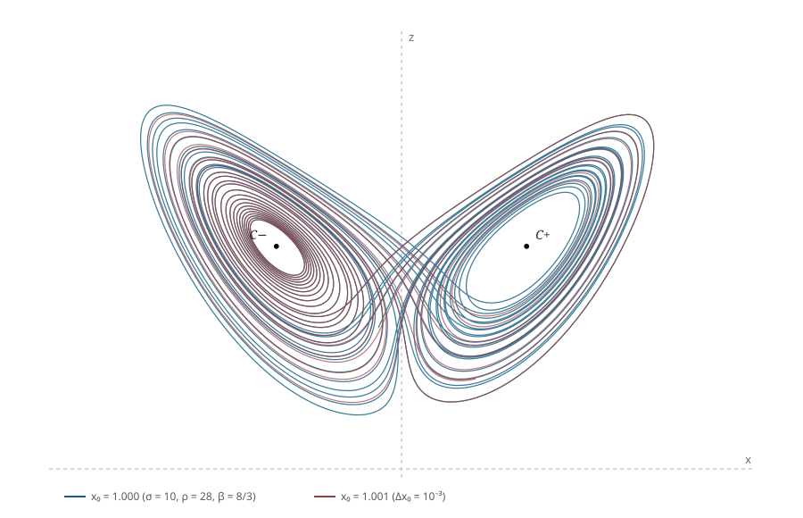

1961年冬，气象学家[爱德华·洛伦兹](https://zh.wikipedia.org/wiki/%E6%84%9B%E5%BE%B7%E8%8F%AF%C2%B7%E8%AB%BE%E9%A0%93%C2%B7%E5%8B%9E%E4%BE%96%E6%AC%A1)为了节省时间，将一组中间运算结果舍入至小数点后三位后重新键入计算机。待他喝完咖啡回到办公室时，却发现模拟出的天气演化序列已与原先截然不同。

<!--more-->

那台[Royal McBee](https://en.wikipedia.org/wiki/Royal_McBee) [LGP-30](https://en.wikipedia.org/wiki/LGP-30)计算机内部保留六位小数，打印纸上呈现的却只有三位：\(0.506127\)变成了\(0.506\)。
千分之一以下的微小差异，在经历数月尺度的数值演化后，被非线性机制放大成了完全不同的气象图景。



洛伦兹后来把这一发现概括为那个著名的问题：

> 一只蝴蝶在巴西扇动翅膀，会在得克萨斯引起一场龙卷风吗？

这并非指蝴蝶直接「导致」了[蝴蝶效应](https://zh.wikipedia.org/wiki/%E8%9D%B4%E8%9D%B6%E6%95%88%E5%BA%94)中的风暴，而是表明：对于此类非线性动力系统，初始条件中任何无法测量的微小差异，都足以在演化中令长期预测失去意义。确定性并不等同于可预测性——这或许是[混沌理论](https://zh.wikipedia.org/wiki/%E6%B7%B7%E6%B2%8C%E7%90%86%E8%AE%BA)留给科学界最深刻的洞见之一。

## 附图生成脚本

上方的洛伦兹吸引子相空间轨线图由以下Python脚本生成：通过四阶龙格-库塔法（RK4）积分洛伦兹方程，并利用方程解析导数构造埃尔米特样条转为SVG三次贝塞尔曲线。

```python {.wrap}
#!/usr/bin/env python3
"""生成洛伦兹吸引子双轨线相空间SVG图（Hermite三次贝塞尔曲线）。"""

import math
from pathlib import Path

SIGMA, RHO, BETA = 10.0, 28.0, 8.0 / 3.0
W, H = 900, 580
SCALE_X = 760.0 / 46.0
SCALE_Y = -480.0 / 52.0


def deriv(x: float, y: float, z: float) -> tuple[float, float, float]:
    return SIGMA * (y - x), x * (RHO - z) - y, x * y - BETA * z


def rk4_step(x: float, y: float, z: float, dt: float) -> tuple[float, float, float]:
    k1 = deriv(x, y, z)
    k2 = deriv(x + 0.5 * dt * k1[0], y + 0.5 * dt * k1[1], z + 0.5 * dt * k1[2])
    k3 = deriv(x + 0.5 * dt * k2[0], y + 0.5 * dt * k2[1], z + 0.5 * dt * k2[2])
    k4 = deriv(x + dt * k3[0], y + dt * k3[1], z + dt * k3[2])
    return (
        x + dt / 6 * (k1[0] + 2 * k2[0] + 2 * k3[0] + k4[0]),
        y + dt / 6 * (k1[1] + 2 * k2[1] + 2 * k3[1] + k4[1]),
        z + dt / 6 * (k1[2] + 2 * k2[2] + 2 * k3[2] + k4[2]),
    )


def sx(x: float) -> float:
    return 70.0 + (x + 23.0) * SCALE_X


def sy(z: float) -> float:
    return 525.0 + z * SCALE_Y


def integrate_hermite(
    x0: float,
    y0: float,
    z0: float,
    total_t: float,
    dt: float = 0.002,
    sample_stride: int = 12,
    skip_t: float = 4.0,
) -> tuple[list[tuple[float, float, float, float]], float]:
    x, y, z = x0, y0, z0
    skip_steps = int(round(skip_t / dt))
    total_steps = int(round(total_t / dt))
    samples = []
    for i in range(skip_steps + total_steps + 1):
        if i >= skip_steps and (i - skip_steps) % sample_stride == 0:
            vx, _, vz = deriv(x, y, z)
            samples.append((sx(x), sy(z), vx * SCALE_X, vz * SCALE_Y))
        x, y, z = rk4_step(x, y, z, dt)
    return samples, dt * sample_stride


def fmt(v: float) -> str:
    s = f"{v:.1f}"
    return "0" if s == "-0.0" else s


def to_cubic_path(samples: list[tuple[float, float, float, float]], seg_dt: float) -> str:
    x0, y0, _, _ = samples[0]
    parts = [f"M{fmt(x0)} {fmt(y0)}"]
    cur_x, cur_y = round(x0, 1), round(y0, 1)
    k = seg_dt / 3.0
    for i in range(len(samples) - 1):
        ax, ay, avx, avy = samples[i]
        bx, by, bvx, bvy = samples[i + 1]
        c1x, c1y = ax + k * avx, ay + k * avy
        c2x, c2y = bx - k * bvx, by - k * bvy
        dx1, dy1 = round(c1x - cur_x, 1), round(c1y - cur_y, 1)
        dx2, dy2 = round(c2x - cur_x, 1), round(c2y - cur_y, 1)
        dx, dy = round(bx - cur_x, 1), round(by - cur_y, 1)
        cur_x = round(cur_x + dx, 1)
        cur_y = round(cur_y + dy, 1)
        parts.append(f"c{fmt(dx1)} {fmt(dy1)} {fmt(dx2)} {fmt(dy2)} {fmt(dx)} {fmt(dy)}")
    return "".join(parts)


s1, dt1 = integrate_hermite(1.0, 1.0, 1.0, total_t=36.0)
s2, dt2 = integrate_hermite(1.001, 1.0, 1.0, total_t=22.0)

c_val = math.sqrt(BETA * (RHO - 1))
cx_p, cx_m, cy = sx(c_val), sx(-c_val), sy(RHO - 1)

svg = f"""<svg version="1.1" xmlns="http://www.w3.org/2000/svg" width="{W}" height="{H}">
<rect fill="rgb(255,255,255)" stroke="none" x="0" y="0" width="{W}" height="{H}"/>
<g stroke="rgb(180,180,180)" stroke-width="1" stroke-dasharray="4,4" fill="none">
  <line x1="{sx(0):.1f}" y1="35" x2="{sx(0):.1f}" y2="535"/>
  <line x1="55" y1="{sy(0):.1f}" x2="845" y2="{sy(0):.1f}"/>
</g>
<g fill="rgb(110,110,110)" font-family="sans-serif" font-size="13">
  <text x="842" y="{sy(0) - 6:.1f}" text-anchor="end">x</text>
  <text x="{sx(0) + 8:.1f}" y="46">z</text>
</g>
<path d="{to_cubic_path(s1, dt1)}" fill="none" stroke="rgb(22,94,131)" stroke-width="1.25" stroke-opacity="0.82" stroke-linecap="round" stroke-linejoin="round"/>
<path d="{to_cubic_path(s2, dt2)}" fill="none" stroke="rgb(158,61,63)" stroke-width="1.15" stroke-opacity="0.72" stroke-linecap="round" stroke-linejoin="round"/>
<g fill="rgb(0,0,0)" stroke="rgb(255,255,255)" stroke-width="1.2">
  <circle cx="{cx_m:.1f}" cy="{cy:.1f}" r="3.5"/>
  <circle cx="{cx_p:.1f}" cy="{cy:.1f}" r="3.5"/>
</g>
<g fill="rgb(43,43,43)" font-family="serif" font-style="italic" font-size="14">
  <text x="{cx_m - 10:.1f}" y="{cy - 8:.1f}" text-anchor="end">C−</text>
  <text x="{cx_p + 10:.1f}" y="{cy - 8:.1f}" text-anchor="start">C+</text>
</g>
<g font-family="sans-serif" font-size="12" fill="rgb(89,88,87)">
  <line x1="72" y1="556" x2="96" y2="556" stroke="rgb(22,94,131)" stroke-width="2"/>
  <text x="102" y="560">x₀ = 1.000 (σ = 10, ρ = 28, β = 8/3)</text>
  <line x1="352" y1="556" x2="376" y2="556" stroke="rgb(158,61,63)" stroke-width="2"/>
  <text x="382" y="560">x₀ = 1.001 (Δx₀ = 10⁻³)</text>
</g>
</svg>
"""

Path("lorenz-attractor.svg").write_text(svg, encoding="utf-8")
```
