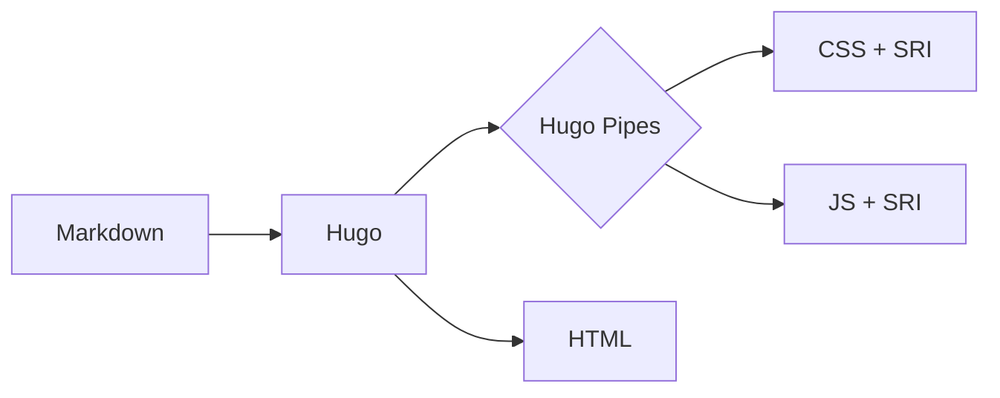
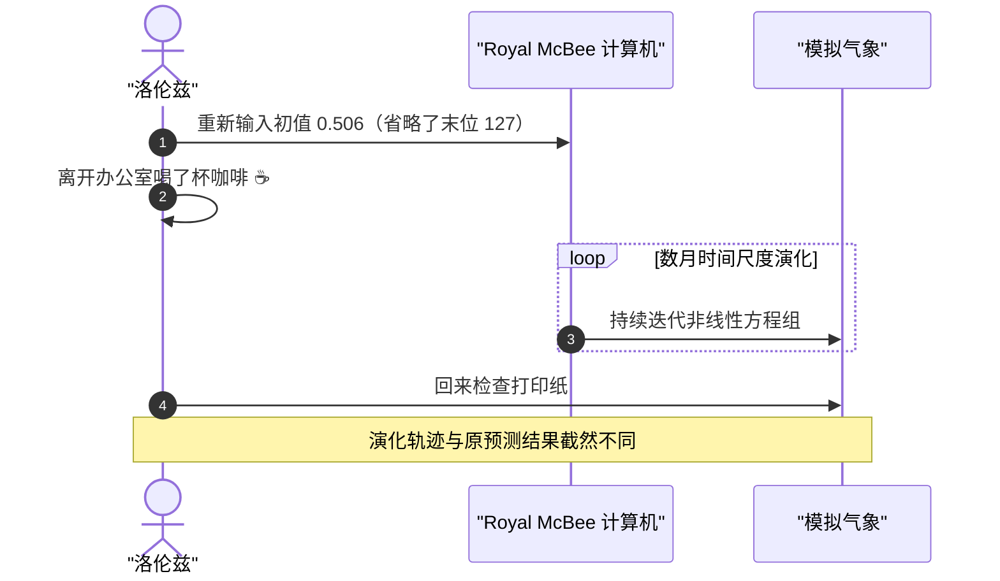

代码块由Hugo内置的[Chroma](https://github.com/alecthomas/chroma)引擎在构建时预先完成静态高亮渲染，
并为浅色与深色模式分别提供适配的配色方案；需要参数微调的代码块支持声明交互变量联动；
[Mermaid](https://mermaid.js.org/)图表则仅在包含图表定义的页面中按需加载。

<!--more-->

## 代码语法高亮与剪贴板交互

代码语法高亮直接在站点构建期由Chroma引擎预先生成静态HTML，
客户端无需加载外部语法高亮脚本。代码块右上角提供复制按钮，
通过原生[Clipboard API](https://developer.mozilla.org/en-US/docs/Web/API/Clipboard_API)
实现文本复制。

以下为计算[逻辑斯谛映射](https://zh.wikipedia.org/wiki/%E9%80%BB%E8%BE%91%E6%96%AF%E8%B0%9B%E6%98%A0%E5%B0%84)(Logistic map)的示例代码。
当控制参数 \(r = 3.9\) 时，该非线性迭代系统将进入混沌区间：

```go
package main

import "fmt"

// logistic 返回逻辑斯谛映射的下一个值。
func logistic(r, x float64) float64 {
	return r * x * (1 - x)
}

func main() {
	x := 0.2
	for i := 0; i < 5; i++ {
		x = logistic(3.9, x)
		fmt.Printf("%d: %.6f\n", i, x)
	}
}
```

以下为[洛伦兹系统](https://zh.wikipedia.org/wiki/%E6%B4%9B%E4%BC%A6%E8%8C%A8%E5%90%B8%E5%BC%95%E5%AD%90)常微分方程组的导数计算函数：

```python
def lorenz(x, y, z, sigma=10.0, rho=28.0, beta=8 / 3):
    """洛伦兹系统的导数。"""
    return sigma * (y - x), x * (rho - z) - y, x * y - beta * z
```

## 可交互代码参数（code_vars） {#code-vars}

在撰写系统配置、运维部署或网络管理文章时，代码与配置片段中常包含具体的主机名、IP地址、子网、密钥或目录路径。

传统写法通常有两种妥协：
1. **写死具体环境的值**：读者复制到自己终端或配置文件后，必须人工逐处查找替换。代码越长、出现的次数越多，越容易漏改或改错。
2. **使用模板占位符**（例如`<HOSTNAME>`、`{{DOMAIN}}`或`$IP`）：这类写法不仅破坏了代码本身的语法合法性，导致语法高亮错乱、无法直接执行测试，在RSS/Atom提要或无JavaScript环境下阅读时更显得零碎残缺。

Chaos采用了**渐进增强（Progressive Enhancement）与零运行时污染**的设计：

- **源码与RSS零污染**：Markdown源码与代码块中直接书写**真实、合法且可直接运行的默认值**（如`router.example.net`或`192.0.2.1`）。在无JavaScript环境、命令行终端（如`w3m`/`curl`）或RSS阅读器中，读者看到的是毫无格式破损的标准示例代码。
- **按需加载与自动装配**：当且仅当文章Front Matter中声明了`code_vars`时，主题才会加载轻量交互脚本（约3 KB），自动在首个匹配代码块上方挂载可折叠的参数面板，并将代码块内对应的默认值升级为可联动的输入标记`<var class="code-var">`。

### 1. Front Matter 配置写法

在文章头部的Front Matter中通过`code_vars`声明参数列表：

````markdown
```yaml
code_vars:
  - name: host
    default: "router.example.net"
    desc: "网关主机名"
  - name: ip
    default: "192.0.2.1"
    desc: "网关管理IP"
  - name: vlan
    default: "guest iot tiot"
    desc: "业务VLAN网段（空格分隔）"
```
````

各字段说明如下：

- `name`：参数英文标识符。同时作为URL查询参数的键名（如`?host=gw.internal&ip=10.0.0.1`）。
- `default`：代码块中实际书写的**合法默认值字面量**。注意必须与Markdown代码块中出现的字面量精确一致。
- `desc`：参数面板中向读者展示的友好说明标签。若省略则自动回退为`name`或默认值。

> [!TIP]
> 代码块内部**直接书写默认值本身**即可，不要添加任何额外的模板标签或宏定义。例如在配置文件或Shell脚本中直接写`router.example.net`和`192.0.2.1`。

### 2. 交互体验与多端协同

页面就绪后，读者可以获得以下交互能力：

1. **参数面板集中调节**：点击代码块上方的「可填写参数」展开面板，修改任意字段，全文所有代码块中对应的参数值将实时联动更新。
2. **代码块行内原地修改（桌面端）**：在桌面端浏览器中，鼠标点击代码块内的高亮参数即可直接光标定位编辑，输入即时同步回面板及其他代码块。
3. **真实生效的剪贴板复制**：点击代码块右上角的「复制」按钮时，复制出的内容会自动应用读者当前修改后的最新参数，无需手动二次修改。
4. **URL状态持久化与分享**：一旦参数被修改，其非默认值会自动同步至浏览器地址栏（如`?host=node1.example.org`）。把该URL分享给同事时，对方打开页面即直接加载填好的配置，并附带参数来源提示。
5. **一键恢复默认**：修改参数后，面板右下角会显示「重置」按钮，随时可一键撤销全部修改并恢复初始默认值。

### 3. 智能匹配与边界判定机制

为了避免暴力字符串查找替换引发的「误伤」，前端替换引擎内置了针对工程代码的边界与语境处理：

- **词法边界保护（Token Boundary）**：精确判定词法边界。例如默认值`192.0.2.1`不会误匹配`192.0.2.10`；`host`不会误伤`hostname`或`ghost`。
- **正则转义点支持（Escaped Dots）**：当默认值包含点号（如`router.example.net`）时，引擎会自动派生出转义点版本（`router\.example\.net`），在`sed`、`awk`、`grep`或过滤规则中均能准确识别与联动。
- **空格分隔转管道（Pipe Alternation）**：若默认值是由空格分隔的多个名称（如`guest iot tiot`），引擎会自动支持正则表达式或模式匹配中的管道形式（`guest|iot|tiot`）。

### 4. 排除特定代码块（`code_vars="false"`）

在记录终端真实执行结果、错误日志或固定版本号等代码块时，往往不希望内容随参数面板而变动。此时可通过Chroma代码块属性添加`{code_vars="false"}`显式禁用替换：

````markdown
```text {code_vars="false"}
# 终端执行日志：添加了 code_vars="false"，保持真实记录不变
$ ping -c 1 router.example.net
PING router.example.net (192.0.2.1): 56 data bytes
64 bytes from 192.0.2.1: icmp_seq=0 ttl=64 time=0.285 ms
```
````

### 5. 现场互动演示

本页面已在Front Matter中声明了上述`code_vars`参数。请尝试在上方参数面板中将网关主机名改为你自己的域名，或者直接在下方代码块中点击编辑，观察双向同步与复制效果：

```sh
# 1. 登录网关并配置管理接口
ssh admin@router.example.net

# 2. 绑定管理IP与测试路由连通性
ifconfig em0 inet 192.0.2.1/24 up
route add default 192.0.2.254

# 3. 遍历隔离网段
for net in guest iot tiot; do
    echo "Configuring VLAN network: ${net}..."
done
```

以下为包含正则转义点的`sed`过滤脚本以及管道表达式：

```sh
# 匹配转义点 router\.example\.net 以及管道 guest|iot|tiot
sed -i '' 's/server=router\.example\.net/done/' /etc/dnsmasq.conf
egrep "(guest|iot|tiot)" /var/log/dhcpd.log
```

而下方代码块因标记了`{code_vars="false"}`，无论上方如何修改，其中的值始终保持固定：

```text {code_vars="false"}
# 命令执行输出样例（保留真实日志，禁止动态替换）
[debug] connected to router.example.net (192.0.2.1) successfully.
```

## Mermaid图表

在Markdown中使用 ```` ```mermaid ```` 代码块即可直接声明图表：

> [!NOTE]
> 代码语法高亮在构建阶段完成，无客户端运行时开销；而Mermaid则需浏览器在前端动态解析并计算图形布局。
> 虽然该脚本仅在包含图表的页面按需加载，但仍需传输约750 KB（Brotli压缩，解压后约3570 KB）。
> 若对单页体积有严格要求，可以考虑在构建前通过命令行工具将图表预渲染为静态SVG图片后再行引入。

### 示例1：构建流程图




### 示例2：时序图（洛伦兹的咖啡时间）

1961年气象模拟中那次著名的「舍入误差」：

````markdown

````

渲染效果如下：


