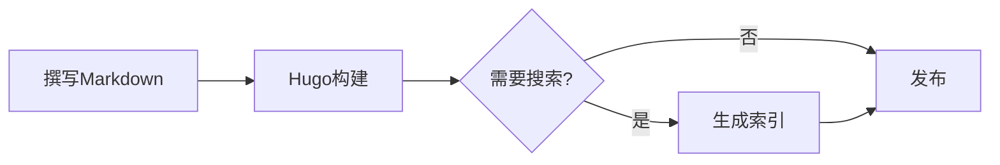
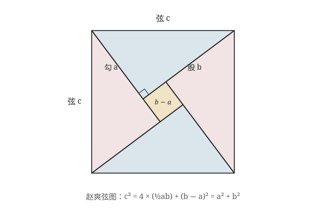

这一页不讲道理，只排样：把主题能渲染的组件按固定顺序放在一起，
调整配色或排版之后，在浅色与深色模式下各看一遍，就能发现哪里出了问题。段落两端对齐、全角标点挤压、楷体灰度与长标识符软断行等混排细节见[另一份混排样张](../typography-specimen/)。

<!--more-->

> [!TIP]
> 本页涵盖楷体强调、米字格、竖排古籍与X静态卡片等全部组件。若直接运行`hugo server --source exampleSite`，未拉取自托管中文字体切片时会自动回退至系统字体；如需完整检验自托管楷体/宋体与站内检索，可先按[快速安装与部署](../quick-start/#webfonts)运行`fetch_webfonts.py`与`build_search_index.py`。

## 正文与行内元素 {#inline}

正文段落使用**粗体**、*楷体与Latin italic*、***加粗楷体与Bold italic***与[着重号]{.}，也可以~~删除~~一段文字。
行内代码如`errno`和`printf("%d\n", x)`使用等宽字体，
链接分为[站内链接](../../archives/)与[站外链接](https://gohugo.io/ "Hugo官方网站")两种。
中文与English、数字2026之间不手动加空格，由CSS自动留出间距。
注音有[漢字]{かんじ}、[汉字]^(hàn zì)、长拼音（浩浩[汤汤]{shāng shāng}）、注音符号四声（[山]^(ㄕㄢ)[明]^(ㄇㄧㄥˊ)[水]^(ㄕㄨㄟˇ)[秀]^(ㄒㄧㄡˋ)与轻声[朋]^(ㄆㄥˊ)[友]^(˙ㄧㄡ)）以及宽于基字的义训（这套[方案]{临时凑合的永久架构}）等用法。
行内色卡支持在文字前展示[蘇芳色]{#9E3D3F}与[半透山吹]{#F8B50055}，也支持贴在色号旁的独立色块[]{#165E83}`#165E83`。
脚注标记出现在句末[^note]，正文末尾会列出脚注内容；脚注里也可以有链接[^link]。

A paragraph in English checks the Latin side of the type: quotation
marks "like these", an em dash --- like this --- and an ellipsis... all pass through the typographer.

### 三级标题

#### 四级标题

四级标题以下很少使用，这里只确认层级关系依然清楚。

## 列表 {#lists}

- 无序列表的第一项
- 第二项包含较长的文字，用来检查换行之后的悬挂缩进是否与首行文字对齐，而不是与项目符号对齐
  - 嵌套的第二层
    - 嵌套的第三层
- 第三项

1. 有序列表
2. 第二步
   1. 嵌套的有序列表
   2. 第二个子项
3. 第三步

- [x] 已完成的任务（可点击切换）
- [ ] 尚未完成的任务
- 混排在同一列表中的普通条目（保留圆点且文字与任务项左对齐）

术语
: 定义列表的解释部分。

定义列表末尾附加`{.dialogue}`块属性时排作访谈体（宽屏下话者悬挂于左栏外，
与列表序号一致）：

访谈者
: 对话体默认采用单色半粗体话者名，适合人物专访与对谈记录。

受访者
: 同一说话人若连续多段发言，直接续写`: `条目即可。
: 第二段会与上一段保持更紧凑的段距，无需重复说话人标签。

访谈者
受访者
: 若两位说话人同时应答或持相同意见，可连续写出多个术语行再接一条解释。
{.dialogue}

剧本排印可附加`{.dialogue .script}`使话者退居次级墨色；独占一行的`*〔…〕*`排为独立舞台提示段落，置于话者后或台词中的`*（…）*`则自动缩为次级动作注记：

*〔场灯渐暗，仅余屏幕微光。〕*

p1 *（低声）*
: Have you tried *measuring* before rewriting the whole service?

p2
: **Never!** *（摊手）* Benchmarks only slow down innovation.
{.dialogue .script}

*〔幕落。〕*

双语对照使用`{.bilingual}`（左栏为主要语言，右栏为对照原文，手机端自动转为先中后外堆叠，并支持按起拖位置锁定单栏复制）：

我们认为下面这些真理是不言而喻的：人人生而平等，造物者赋予他们若干不可剥夺的权利，其中包括生命权、自由权和追求幸福的权利。
: We hold these truths to be self-evident, that all men are created equal, that
  they are endowed by their Creator with certain unalienable Rights, that among
  these are Life, Liberty and the pursuit of Happiness.

为了保障这些权利，人类才在他们之间建立政府，而政府之正当权力，是经被治理者的同意而产生的。
: That to secure these rights, Governments are instituted among Men, deriving
  their just powers from the consent of the governed.
{.bilingual}

诗词、歌词中刻意手打的节奏停顿空格，或需跳过CJK空格清理的区块，可附加`{.keep-space}`：

明月 几时有  把酒 问青天
{.keep-space}

成语、生字或训诂字帖展示可对段落附加`{.mizige}`（字数与空格分隔的音节数相等时自动按字拆格，下方释义保持普通正文）：

[守株待兔]{shǒu zhū dài tù}
{.mizige}

比喻死守狭隘经验，不知变通，或妄想不劳而获。使用注音符号标注四声（阴平、阳平、上声、去声）时（语出宋·黄庭坚《寄黄几复》「江湖夜雨十年灯」）：

[江湖夜雨]{ㄐㄧㄤ ㄏㄨˊ ㄧㄝˋ ㄩˇ}
{.mizige}

## 引用 {#quotes}

> 引用使用无边框的浅色底块，字号略小于正文，但颜色不变淡。
>
> > 嵌套的引用。
>
> 引用里也可以有`行内代码`和[链接](https://commonmark.org/)。

独立语录可附加`{.quote}`，以破折号开头的末段自动右对齐并弱化为出处署名：

> It is better to remain silent at the risk of being thought a fool, than to talk and remove all doubt of it.
>
> — Maurice Switzer, *Mrs. Goose, Her Book* (1907)
{.quote}

末段不以破折号开头时，仍是引文本身：

> 第一段引文。
>
> 第二段引文，没有出处署名，保持原样。
{.quote}

## 提示框 {#callouts}

> [!NOTE]
> NOTE：背景信息与补充说明，含一个[链接](https://example.org/)。

> [!TIP]
> TIP：使用技巧与建议。

> [!IMPORTANT]
> IMPORTANT：必须了解的关键前提。

> [!WARNING]
> WARNING：需要特别注意的警示。

> [!CAUTION]
> CAUTION：可能造成严重后果的操作。

> [!HISTORICAL]
> HISTORICAL：内容已过时，仅作存档。

> [!DISCLAIMER]
> DISCLAIMER：免责声明。

> [!NOTE] 带自定义标题和代码的提示框
> 提示框里的代码块：
>
> ```sh
> sysctl kern.osreldate
> ```

> [!TIP] 折行的首段与第二段
> 第一段在源码中折成两行，
> 行间的换行在渲染时被去掉。
>
> 第二段与第一段之间有空行，应保持为独立的段落。

> [!NOTE] 折行处是英文单词
> 这一段的第一行以英文结尾：FreeBSD ships
> with ZFS，行间的换行被保留，但仍应渲染为同一个段落。

> [!DETAILS] 默认折叠的中性细节卡片（含`行内代码`）
> 用于收纳作弊条或长文中的可选背景细节，屏幕阅读时默认收起，打印时自动展开：
>
> - 支持嵌套列表与[外部链接](https://example.org/)；
> - 支持浏览器页内查找自动展开。

> [!DETAILS]+ 默认展开的中性细节卡片
> 在`[!DETAILS]`后加`+`即默认展开，视觉节奏与`code_vars`面板一致。

> [!TIP]- 带色可折叠提示框（默认折叠）
> 在任意提示框类型后加`-`（折叠）或`+`（展开），保留对应和色卡片与图标。更多用法参见[](../alerts-and-callouts/)。

多方案切换使用相邻的`> [!TAB] 标题`块自动编组（支持键盘左右方向键切换、浏览器页内查找自动展开、脚注与嵌套提示框原生解析，打印与RSS平铺降级；详例见[](../alerts-and-callouts/#tabs)）：

> [!TAB] TOML
> ```toml
> [params.search]
>   enable = true
> ```
{label="配置格式"}

> [!TAB] YAML
> ```yaml
> params:
>   search:
>     enable: true
> ```

> [!TAB] JSON
> ```json
> {
>   "params": {
>     "search": { "enable": true }
>   }
> }
> ```

标签数量超出容器宽度时，标签栏保持单行横向滚动并在截断边缘渐隐，同时在右侧显示`⋯`弹出菜单以便一键跳转；使用键盘方向键或`End`跳至末项时自动将当前标签滚入视口：

> [!TAB] FreeBSD (pkg)
> ```sh
> pkg install gohugo
> ```
{label="各系统安装 Hugo"}

> [!TAB] macOS (Homebrew)
> ```sh
> brew install hugo
> ```

> [!TAB] macOS (MacPorts)
> ```sh
> sudo port install hugo
> ```

> [!TAB] Debian / Ubuntu
> ```sh
> sudo apt-get install hugo
> ```

> [!TAB] Fedora / RHEL
> ```sh
> sudo dnf install hugo
> ```

> [!TAB] Arch Linux
> ```sh
> sudo pacman -S hugo
> ```

> [!TAB] Alpine Linux
> ```sh
> apk add hugo
> ```

> [!TAB] openSUSE
> ```sh
> sudo zypper install hugo
> ```

> [!TAB] OpenBSD
> ```sh
> doas pkg_add hugo
> ```

> [!TAB] NetBSD (pkgsrc)
> ```sh
> pkgin install go-hugo
> ```

> [!TAB] Windows (winget)
> ```sh
> winget install Hugo.Hugo
> ```

> [!TAB] Nix
> ```sh
> nix-shell -p hugo
> ```

## 表格 {#tables}

| 色名 | 读音 | 色值 | 用途 |
| :--- | :--- | :---: | ---: |
| [生成り色]{#FBFAF5} | Kinari-iro | `#FBFAF5` | 页面底色 |
| [練色]{#EDE4CD} | Neri-iro | `#EDE4CD` | 悬停与选中 |
| [蘇芳]{#9E3D3F} | Suō | `#9E3D3F` | 主色 |
| [藍色]{#165E83} | Ai-iro | `#165E83` | 链接 |
| [墨]{#595857} | Sumi | `#595857` | 次要文字 |

较宽的表格应在窄屏上横向滚动，而不是撑破版面：

| 参数 | 默认值 | 最小值 | 最大值 | 单位 | 说明 |
| :--- | ---: | ---: | ---: | :---: | :--- |
| `vfs.zfs.arc_max` | 0 | 67108864 | 物理内存 | 字节 | ARC缓存的上限，0表示由系统自动决定 |
| `kern.maxfiles` | 自动 | 1024 | 2147483647 | 个 | 系统范围内可同时打开的文件数 |

若列数较多但每格内容简短、适合折行，可附加`{.fixed}`启用等宽列与折行表头（表头中的括号限定词会自动允许换行并挤压标点），并用`caption`指定表题：

| 压缩算法 | 压缩比（典型） | 压缩速度（相对） | 解压速度（相对） | 适用场景（建议） |
| :--- | :---: | :---: | :---: | :--- |
| `lz4` | 2.1× | 极快 | 极快 | ZFS默认、热数据 |
| `zstd-3` | 3.1× | 快 | 极快 | 归档与常规日志 |
| `gzip-9` | 3.3× | 慢 | 快 | 静态资源预压缩 |
| `brotli-11` | 3.8× | 极慢 | 快 | Web文本离线分发 |
{.fixed caption="常见压缩算法特征速查"}

## 代码 {#code}

不足五行的代码块不显示行号：

```sh
$ uname -r
15.0-RELEASE
```

五行以上的代码块显示行号，并高亮第8至9行。这段C代码同时用到关键字、预处理指令、
字符串、数值、函数名与注释：

```c {hl_lines=[8,9]}
#include <stdio.h>
#include <stdlib.h>

#define ITERATIONS 5

/* 逻辑斯谛映射：r 在 3.9 附近进入混沌区间 */
static double
logistic(double r, double x)
{
	return (r * x * (1.0 - x));
}

int
main(void)
{
	double x = 0.2;

	for (int i = 0; i < ITERATIONS; i++) {
		x = logistic(3.9, x);
		printf("%d: %.6f\n", i, x);
	}
	return (EXIT_SUCCESS);
}
```

Python代码检查类名、装饰器与内置函数的配色：

```python
from dataclasses import dataclass


@dataclass
class Colour:
    """一种传统色。"""
    name: str
    hex: str

    def rgb(self) -> tuple[int, int, int]:
        # 去掉开头的「#」，每两位一组
        return tuple(int(self.hex[i:i + 2], 16) for i in (1, 3, 5))


print(Colour("蘇芳", "#9E3D3F").rgb())
```

HTML代码检查标签与属性的配色：

```html
<figure class="x-card" id="x-204125811366830080">
  
  <figcaption>色票</figcaption>
</figure>
```

差异代码检查增删行的底色：

```diff
--- a/tokens.css
+++ b/tokens.css
@@ -193,3 +193,3 @@
-      --bg: #1F1E1D;
+      --bg: #151514;
       --surface: #1B1B19;
```

按需启用软折行（`{.wrap}`）的代码块检查长行折行后逻辑行号与空行高度的对齐：

```markdown {.wrap}
在人类历史事件的进程中，当一个民族有必要解除其与另一个民族之间的政治纽带，并在世界列国之中取得独立而平等的地位时，出于对人类舆论的恰当尊重，她应当把促使其独立的缘由昭告天下。
: When in the Course of human events, it becomes necessary for one people to dissolve the political bands which have connected them with another, a decent respect to the opinions of mankind requires that they should declare the causes which impel them to the separation.

我们认为下面这些真理是不言而喻的：人人生而平等。
: We hold these truths to be self-evident, that all men are created equal.
{.bilingual}
```

没有语言标记的预格式文本：

```
+--------+     +--------+
| client | --> | server |
+--------+     +--------+
```

## 公式 {#math}

行内公式\(e^{i\pi} + 1 = 0\)与正文同行排列，独立公式居中显示：

$$
x_{n+1} = r\,x_n\,(1 - x_n), \qquad r \in [0, 4]
$$

## 图表 {#diagram}



## 图片 {#image}

页面包中的位图（PNG/JPEG）会生成多种尺寸与WebP版本，点击可弹出放大预览：


页面包中的SVG矢量图默认在构建期自动补齐`viewBox`、移除纯白底板并适配暗色模式，点击后支持滚轮矢量缩放与拖拽平移：



同一张SVG在URL后附加`#raw`可跳过构建期改写与暗色反色，保留原样：


## 嵌入卡片 {#embed}

X（Twitter）的帖子从构建时缓存的数据渲染成静态卡片，不加载第三方脚本：



## 竖排与古籍引文 {#vertical}

引用块或段落附加`{.vertical}`即可切换为独立竖排容器，保留传统从右至左、自上而下的阅读顺序，并支持篇名（`title="..."`）、落款、`{.ruled}`乌丝栏、`{.red-ruled}`朱丝栏、抬头（`　`挪抬、行首`^`单抬、`^^`双抬）、`((...))`双行夹注、`((:批注))`/`{.side-notes}`行间旁批与`[文字]{o}`空心圈点（完整长文与分叶演示见[竖排与古籍引文](../vertical-typesetting/)）：

> [關關雎鳩]{o}，在河之洲。
> 窈窕淑女，[君子好逑]{.}。
>
> — 《詩經·周南·關雎》
{.vertical}

带朱丝栏、双行夹注、抬头与偏右侧书小字的古籍示例：

> 黃帝者，少典之子((集解：譙周曰有熊國君，少典之子也。))，姓公孫，名曰軒轅。
>
> ^^天子聖明，仁德廣被。
>
> [臣]{-}謹奏，感念　皇恩，四海歸心。
>
> — 仿古籍行款示例
{.vertical .ruled .red-ruled}

竖排容器内的注音符号四声（阴平、阳平、上声、去声）对照：

> [春]{ㄔㄨㄣ}[眠]{ㄇㄧㄢˊ}[不]{ㄅㄨˋ}[覺]{ㄐㄩㄝˊ}[曉]{ㄒㄧㄠˇ}，[處]{ㄔㄨˋ}[處]{ㄔㄨˋ}[聞]{ㄨㄣˊ}[啼]{ㄊㄧˊ}[鳥]{ㄋㄧㄠˇ}。
>
> — 唐·孟浩然《春曉》
{.vertical .ruled}

## 分隔线 {#rule}

分隔线上方的段落。

---

分隔线下方的段落。

[^note]: 脚注的内容出现在文章末尾，带有返回正文的链接。
[^link]: 脚注语法见[CommonMark的扩展说明](https://github.github.com/gfm/)。打印时，脚注与正文中的链接合编为同一组「注释」。
